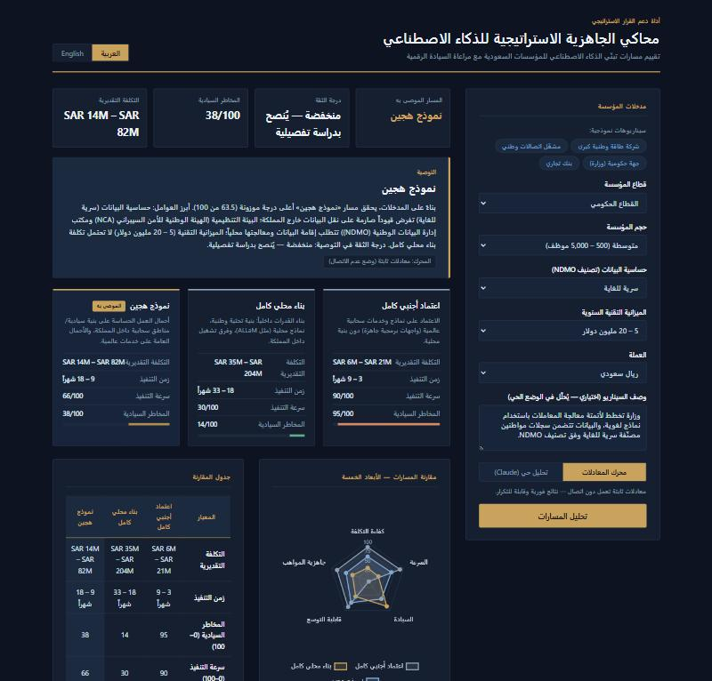
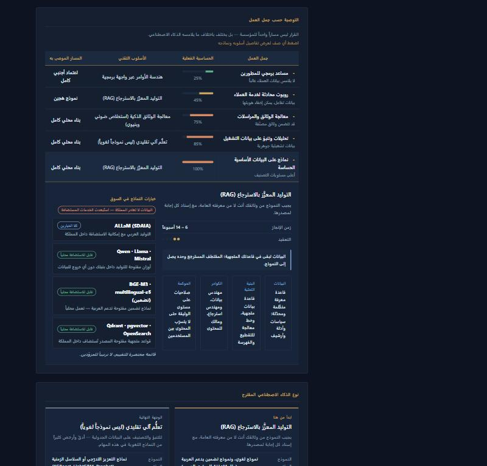
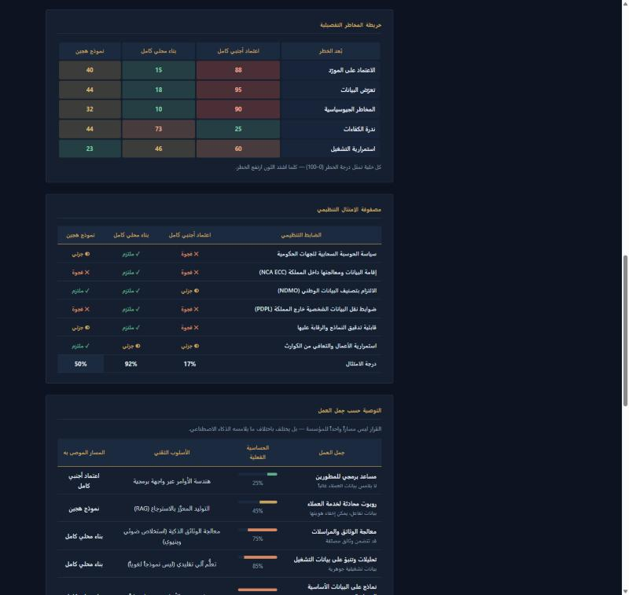
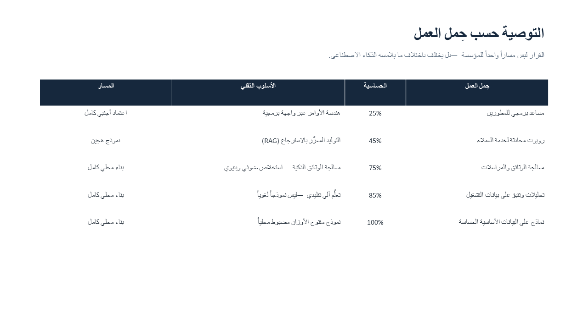

# Bawsala · بوصلة
### Strategic AI Readiness Simulator — محاكي الجاهزية الاستراتيجية للذكاء الاصطناعي

> A strategic decision-support simulator that helps Saudi organizations choose an AI adoption path — balancing cost, execution speed, and digital sovereignty — then tells them which AI technique to use, what it requires, and produces a board-ready decision memorandum and deck.

> أداة محاكاة استراتيجية تساعد المؤسسات السعودية على اختيار مسار تبنّي الذكاء الاصطناعي بموازنة التكلفة وسرعة التنفيذ والسيادة الرقمية، ثم تحدّد الأسلوب التقني المناسب ومتطلباته، وتُخرج مذكرة قرار وعرضاً تقديمياً جاهزين لمجلس الإدارة.

**ABDULLAH ALADHYANI**

---

## The problem | المشكلة

Every regulated organization in Saudi Arabia faces the same strategic question: adopt global AI services (fast and inexpensive, but data leaves the Kingdom), build sovereign capability in-house (full control, but costly and slow), or run a hybrid model?

Answering it properly normally requires a consulting engagement measured in months. This simulator compresses that analysis into minutes — grounded in the regulatory reality of the Saudi market: NCA ECC, NDMO data classification, PDPL, SAMA, CST, and HCIS.

تواجه كل مؤسسة منظَّمة في المملكة السؤال نفسه: هل نعتمد على خدمات ذكاء اصطناعي عالمية جاهزة، أم نبني قدرة سيادية داخلية، أم نمضي بنموذج هجين؟ الإجابة عادةً تستغرق أشهراً من العمل الاستشاري — وهذه الأداة تختصرها إلى دقائق، مبنيةً على الواقع التنظيمي السعودي.

## What it does | ما تفعله

Four inputs — **sector, organization size, data sensitivity, technology budget** — produce a complete strategic comparison of three adoption paths, scored on cost, timeline, sovereignty risk, execution speed, scalability, and talent readiness.

## The decision is not one path | القرار ليس مساراً واحداً

The simulator's central argument: an organization does not pick one path. The right answer differs by **what the AI actually touches** — and each workload implies a different technique with different requirements.

| Workload | Effective sensitivity | Technique | Path |
|---|---|---|---|
| Developer coding assistant | low | Prompt engineering | Foreign |
| Customer-service chatbot | moderate | Retrieval-Augmented Generation | Hybrid |
| Document processing | high | Intelligent document processing | Sovereign |
| Operational analytics | high | **Classical ML — not an LLM** | Sovereign |
| Core sensitive data | highest | Locally fine-tuned open-weight model | Sovereign |

Nothing here is a fixed lookup. The technique is **scored per workload** against the organization's own constraints — budget capacity, team depth, sector tilt and the residency requirement — so a small entity on a tight budget is steered away from techniques it cannot staff, while a well-funded enterprise is pushed deeper.

**Select any workload row** and it expands in place to show that workload's technique, its lead time and complexity, what it requires across **data, infrastructure, team and governance**, and a shortlist of **named models available on the market**. Where the workload's data may not leave the Kingdom, hosted services are filtered out of that shortlist automatically and the exclusion is stated — so the same table recommends Claude or GPT for a coding assistant and ALLaM, Qwen or Llama for core classified data.

## Risk and compliance | المخاطر والامتثال

The headline sovereignty score is decomposed into five sub-dimensions — vendor lock-in, data exposure, geopolitical exposure, talent scarcity, and operational continuity — because "risk" is never one number. Each path is then scored against the controls that actually apply to the selected sector, including a sector-specific control (SAMA for financial, CST for telecom, HCIS for energy, cloud policy for government). Selecting Top Secret data automatically tightens the assessment.

## Board deliverables | مخرجات مجلس الإدارة

- **PDF decision memorandum** — executive page, comparison table, compliance matrix, AI approach with its requirements, roadmap, final recommendation, and a sign-off block.
- **PowerPoint deck** — eight slides in the same structure, because consultants present in PowerPoint rather than PDF.

Both export in **Arabic or English**, in **Saudi Riyal or US Dollar**, with correct Arabic typography and right-to-left layout throughout.

## Full capability list | قائمة المزايا

**Analysis**
- **Dual engine** — a deterministic offline engine (instant, repeatable, no network) plus an optional live engine that interprets a free-text scenario. The live engine falls back to the offline model transparently on any failure, and the interface always states which engine produced the result.
- **Automatic recommendation** with a written board-level justification and a stated confidence level.
- **Decision-weight transparency** — the weighting applied is shown to the user, not hidden behind a score. Weights shift with the inputs: higher sensitivity and stricter regulation raise the sovereignty weight; a smaller budget raises the cost weight.
- **Methodology panel** — every formula behind the numbers is explained in the interface, alongside links to the primary regulatory sources.

**Financial modelling**
- **Five-year cumulative cost curve** with automatic break-even detection, exposing the real financial commitment beyond year one.
- **Cost breakdown** — CAPEX/OPEX split and spend distribution across infrastructure, licenses, talent, and integration.
- **Dual currency** — Saudi Riyal or US Dollar across the interface and every export.

**Risk, compliance and execution**
- Detailed five-dimension risk map.
- Regulatory compliance matrix with a per-path compliance percentage.
- Per-workload technique recommendation, scored against the organization's constraints, with requirements and a named-model shortlist filtered by data residency.
- Expandable workload rows — each reveals its own technique, requirements and model options in place.
- Four-phase implementation roadmap specific to the recommended path.

**Experience**
- Full Arabic/English interface with correct RTL layout, a dark executive theme, and a responsive phone layout.
- Save and compare several analyses side by side.

## Technical overview | نظرة تقنية

| Layer | Stack |
|---|---|
| Backend | Python · Flask |
| Analysis engine | Parametric deterministic model with an optional LLM-assisted layer |
| Frontend | React · Chart.js · bilingual RTL interface, no build step |
| Reporting | ReportLab (PDF) · python-pptx (PowerPoint), with bundled Arabic typography |

The application runs entirely offline by default: front-end dependencies are vendored locally, fonts are bundled rather than taken from the host OS, and the default engine requires no network access and no API key.

### Engineering notes | ملاحظات هندسية

The hardest part of this project was not the model — it was **Arabic typography in generated documents**:

- ReportLab has no bidirectional text engine, so reordering a whole paragraph before line-breaking produced pages whose lines read bottom-to-top. The fix wraps text to measured width first, then reorders each line independently.
- The bidi algorithm infers paragraph direction from the first strong character, so any line beginning with a Latin acronym such as `(NCA)` was laid out left-to-right and rendered mirrored. Direction is now forced explicitly.
- PowerPoint applies its own bidi engine, which drops the space between a digit and an Arabic word at a direction boundary and mirrors brackets around Arabic phrases. Both are handled by a sanitizer in the export layer.

## Methodology notes | ملاحظات منهجية

- Data sensitivity levels mirror the NDMO national data classification scheme (Public / Internal / Confidential / Top Secret).
- Regulatory weighting per sector reflects the intensity of that sector's supervisory regime.
- Cost figures are **indicative planning ranges** produced by a parametric model. They are not quotations and do not replace a detailed feasibility study.
- The compliance matrix expresses a typical posture per path. An actual compliance determination requires review by the relevant regulator and the organization's own compliance function.

## Disclaimer | إخلاء مسؤولية

This is a decision-support simulation tool. All outputs are indicative and intended to structure a strategic discussion — not to serve as financial, legal, or regulatory advice.

أداة محاكاة لدعم القرار؛ جميع المخرجات استرشادية وتهدف إلى تنظيم النقاش الاستراتيجي، ولا تُعدّ استشارة مالية أو قانونية أو تنظيمية.

## Source code | الكود المصدري

This repository presents the project and its capabilities. The source code is kept private; access can be arranged on request for evaluation purposes.

هذا المستودع يعرض المشروع ومزاياه. الكود المصدري خاص، ويمكن ترتيب الاطلاع عليه عند الطلب لأغراض التقييم.

## License | الترخيص

Documentation and project materials in this repository © 2026 ABDULLAH ALADHYANI. See [LICENSE](LICENSE).

---

Built by **ABDULLAH ALADHYANI**
